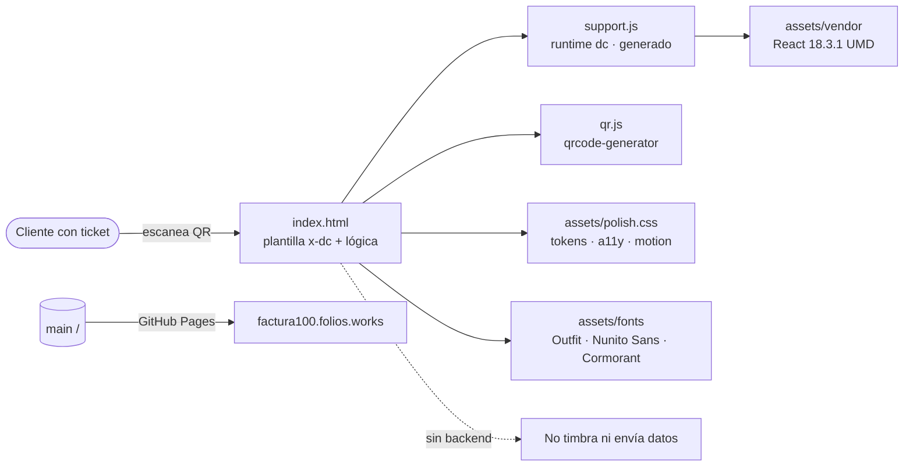

<p align="center">
  
</p>

<h1 align="center">Portal 100% Natural · autofactura</h1>

<p align="center"><b>Vista previa de diseño del portal de autofactura de 100% Natural, hecho con <a href="https://folios.works">Folios</a></b><br>
<a href="https://factura100.folios.works/">factura100.folios.works</a></p>

## Qué es

Una página estática que muestra el flujo completo de autofactura de 100% Natural: el cliente escanea el QR del comprobante de su ticket (o escribe el folio), captura sus datos fiscales una sola vez y recibe su CFDI con XML y PDF ("Tu factura, en dos pasos"). Incluye el escáner, el acceso sin contraseña a "Mis facturas", la tira de mensajes, el pie de marca y a Fausto, el asistente de Folios.

Es **solo diseño**: no emite, no timbra y no envía datos a ningún servidor. Sirve para que el comercio, ventas y operación revisen el flujo antes de construir el producto. La guía del paquete promocional está en [`docs/PROMO-PACKAGE-IMPLEMENTATION-GUIDE.md`](docs/PROMO-PACKAGE-IMPLEMENTATION-GUIDE.md).

## Arquitectura



Cómo arranca la página:

1. El navegador pinta al instante un **shell estático** (`#na-shell`, fondo verde con el logo) y el enlace "Saltar al contenido".
2. `support.js` (con `defer`) carga React desde `assets/vendor/` (mapeado con `window.__resources`, sin CDN de terceros), lee la plantilla dentro de `<x-dc>` y la lógica en `<script type="text/x-dc" data-dc-script>`, y renderiza el portal.
3. En cuanto aparece `[data-screen-label]`, el shell se desvanece y se elimina.

## Estructura

```text
index.html                 página: <head> SEO/OG, shell, plantilla <x-dc> y lógica
404.html                   página de error con la misma marca (GitHub Pages la sirve sola)
support.js                 runtime dc (GENERADO, no editar a mano)
qr.js                      qrcode-generator 1.4.4 (QR del paso "Escanea con tu teléfono")
assets/polish.css          capa de diseño: tokens, foco, contraste, responsivo, movimiento reducido
assets/fonts.css + fonts/  Google Fonts autoalojadas (OFL), subconjunto latin
assets/vendor/             react / react-dom 18.3.1 (MIT), mismos bytes que pide el runtime (SRI idéntico)
assets/img/                logos WebP a tamaño de uso, íconos PWA, og-card.jpg (1200×630)
favicon.ico · favicon.svg · apple-touch-icon.png · site.webmanifest
robots.txt · sitemap.xml   indexación del dominio factura100.folios.works
CNAME                      dominio propio de GitHub Pages (no borrar)
na-*.png · palmera-*.svg   recursos de marca (los PNG grandes se usan en el paquete promo)
docs/                      guía promo y sistema de diseño
```

## Editar

No hay dependencias ni paso de build.

```bash
python3 -m http.server 8000   # y abre http://localhost:8000
```

- **Textos y pantallas**: dentro de `<x-dc>` en `index.html`. Los valores dinámicos usan `{{ clave }}` y vienen del objeto que devuelve la lógica (`<script type="text/x-dc" data-dc-script>`, al final del archivo). `sc-if` y `sc-for` son condicionales y listas.
- **Estilos**: casi todo el estilo del componente está en línea. Para ajustes globales (tipografía, espaciado, foco, responsivo) usa `assets/polish.css` y sus variables `--na-*`; los selectores van como `html [data-na="..."]` para ganar a las reglas del componente. Ver [`docs/DESIGN-SYSTEM.md`](docs/DESIGN-SYSTEM.md).
- **Atributos**: escribe HTML normal (`aria-label`, `autocomplete`, `role`, `type="button"`); el runtime los pasa tal cual.
- **No edites `support.js`**: es código generado. Para cambiar de dónde salen React o Babel usa `window.__resources` en el `<head>`.
- Antes de subir: revisa con Lighthouse (móvil y escritorio) y navega con el teclado (Tab) para confirmar que el foco se ve.

## Desplegar

GitHub Pages publica la rama `main` desde la raíz (despliegue clásico "branch", sin Actions). Todo lo que se fusiona a `main` queda publicado en uno o dos minutos.

- Dominio: `https://factura100.folios.works/` (archivo `CNAME`).
- URL de proyecto: `https://friskydevelopments.github.io/portal-100-natural-preview/` redirige al dominio.
- Las rutas son relativas (`./`), salvo `404.html`, que usa rutas absolutas (`/assets/...`) porque GitHub la sirve en cualquier ruta inexistente; funciona en el dominio propio.

## Dominio y DNS

| Nombre | Tipo | Valor | Proxy |
| --- | --- | --- | --- |
| `factura100.folios.works` | CNAME | `friskydevelopments.github.io` | Solo DNS (gris) |

- La zona `folios.works` vive en Cloudflare (nameservers `dalary.ns.cloudflare.com` y `gannon.ns.cloudflare.com`). El apex y `www` sirven el sitio de Folios (Framer); no los toca este repo.
- El registro de `factura100` debe quedar **en gris (solo DNS)** para que GitHub pueda emitir el certificado de Let's Encrypt.
- HTTPS: en *Settings → Pages* confirma que el dominio aparece como verificado y activa **Enforce HTTPS** cuando GitHub termine de emitir el certificado. Si se queda atorado, quita y vuelve a guardar el dominio en esa pantalla para reintentar la emisión.

## Licencias de terceros

- React y ReactDOM 18.3.1: MIT.
- Outfit, Nunito Sans y Cormorant Garamond: SIL Open Font License 1.1.
- qrcode-generator 1.4.4: MIT.
